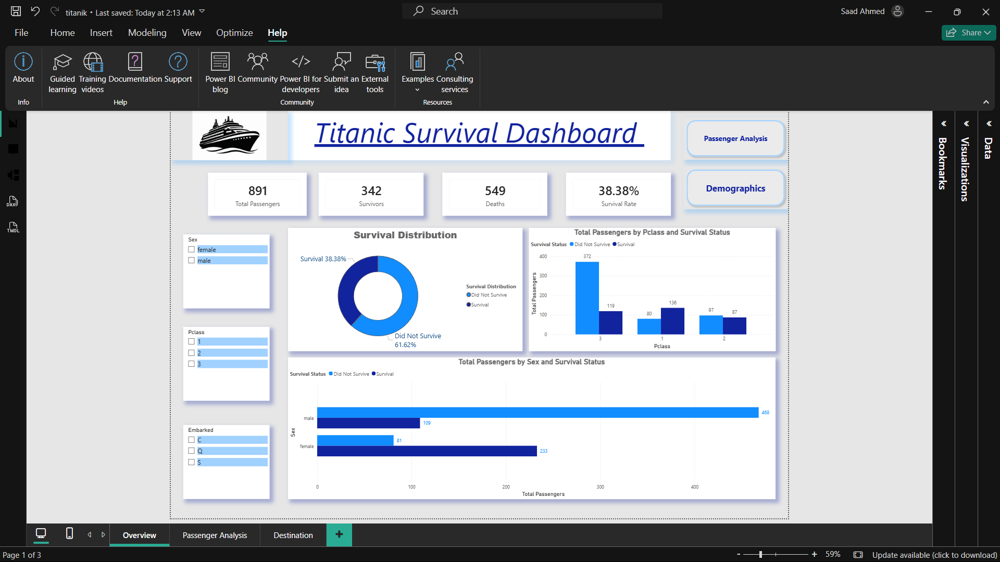
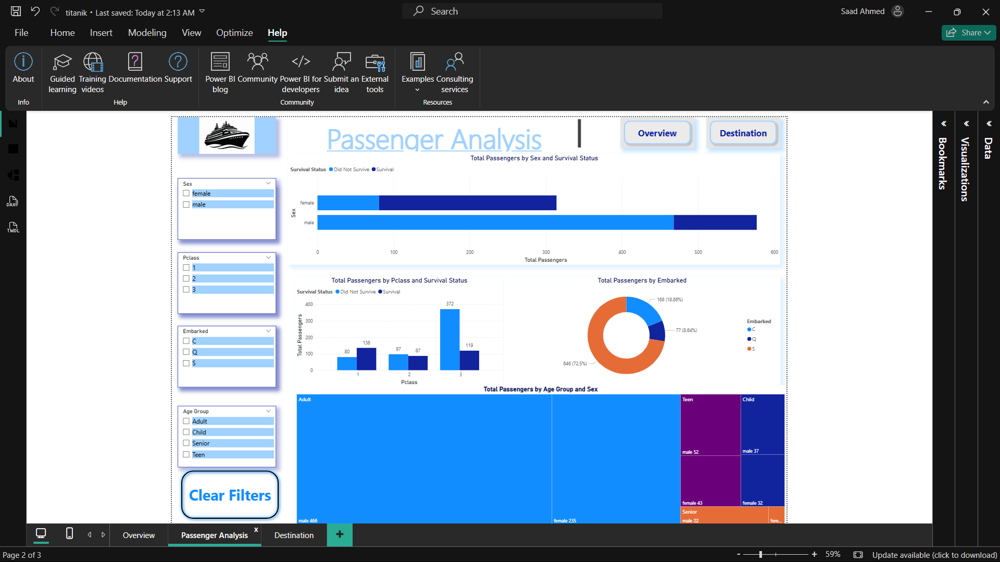

# Titanic Survival Dashboard

Power BI dashboard and report exploring passenger survival in the Titanic dataset.

## Dashboard previews

### Overview

### Passenger analysis

## Files

All project files are in the repository root:

| File | Purpose |
|---|---|
| [PowerBI-Titanic-Dashboard.pbix](PowerBI-Titanic-Dashboard.pbix) | Power BI dashboard |
| [Titanic_Analysis_Report.docx](Titanic_Analysis_Report.docx) | Written analysis report |
| [train.csv](train.csv) | Training dataset with survival labels |
| [test.csv](test.csv) | Test dataset without survival labels |
| [gender_submission.csv](gender_submission.csv) | Example submission |
| `overview.png`, `passenger_analysis.png` | Exported dashboard previews |

## Open the project

1. Download or clone this repository.
2. Open `PowerBI-Titanic-Dashboard.pbix` in Microsoft Power BI Desktop.
3. If Power BI asks for a source location when refreshing, point the queries to the CSV files in your local copy.
4. Use the included report and screenshots to review the analysis without Power BI Desktop.

The repository does not include a Python analysis script or a hosted dashboard. The PBIX file is the dashboard entry point; there is no `analysis.py` command to run.

## Scope

The project explores survival alongside passenger attributes such as sex, age and ticket class. The CSV files, report and dashboard previews are included for inspection. The refresh workflow has not been independently tested on a fresh Windows installation.
